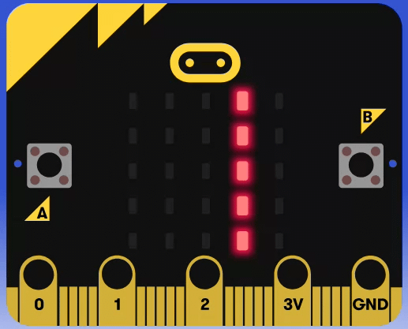

# TP - carte microbit

Dans ce TP, nous allons programmer un objet connecté : __une carte microbit__  

> [!TIP] 
> __Généralités__
> 1. Une carte microbit est un objet programmable. Nous n'avons pas de vraie carte donc nous nous contenterons d'en simuler une en allant sur le site [Makecode](https://makecode.microbit.org/)  
> 2. Pour __chaque__ Question du TP nous allons créer un noueau projet.(aucune autre possibilité pour sauvegarder son programme)      
> Cliquez sur __"Nouveau projet"__ puis nommez celui-ci __Q1__.(Par la suite il faudra créer un projet nommé __Q2__ etc...)  
> 3. Vérifiez bien en haut du site que la section __"Blocs"__ est selectionnée.     
> 4. 2 blocs sont déjà déposés au centre :
>   - `"au démarrage"`  
>   - `"toujours"` : l'endroit où nous poserons chaque bloc

> [!TIP] 
> __Q1__
> Dans la section __"LED"__ prenez le bloc `allumer x 0 y 0` puis placez le dans le bloc central `toujours`. 
> Observez sur la carte que la LED en haut à gauche est allumé.  
> Allez maintenant dans la section __"Base"__ prenez un bloc `pause (ms) 100` que vous mettrez en dessous du premier bloc.  
> Allez dans la section __"LED"__ prenez le bloc `eteindre x 0 y 0`  
> Puis reprenez un bloc `pause (ms) 100`.
> __Astuce : il est possible de faire un clique droit sur un bloc pour le copier-coller__  
> La led en haut à gauche de la carte microbit devrait clignoter frénétiquement !

> [!TIP] 
> __Q2__  
> Retournez sur la page initial en cliquant sur "micro:bit" en haut à gauche de votre page
> Cliquez sur "Nouveau Projet" nommé le __Q2__  
> Créer un programme par bloc qui allume les LED de la deuxième ligne une à une.
> Une nouvelle LED doit s'allumer toutes les 200 ms.   
> On doit donc,
> - Avoir la 1re LED(situé en x=0 et y=1) qui s'allume
> - attendre 200ms
> - La 2ème LED(situé en x=1 et y=1) qui s'allume
> - attendre 200ms
> - etc...
> A la fin du programme, lorsque toutes les LED sont allumées, ajoutez les blocs permettant d'éteindre toutes les LED    

> [!TIP]   
> __Q3__   
> Retournez sur la page initial en cliquant sur "micro:bit" en haut à gauche de votre page  
> Cliquez sur "Nouveau Projet" nommé le __Q3__.  
> Nous allons réeffectuer __exactement le même programme__ qu'à la __Q2__ mais cette fois-ci avec moins de blocs. 
> Pour cela, nous allons utiliser une __Boucle__.    
> Allez dans la sections __Boucles__ et prenez le bloc `"pour index variant de 0 à 4"` puis glissez le dans le bloc `toujours`.   
> Prenez maintenant un bloc `allumer x0 y0` et un bloc `pause (ms) 100` et mettez ces 2 blocs dans celui de la boucle(le vert).  
> Allez, maintenant dans la section `Variables` et prenez la variable nommée `index`. Puis déposer la à la place du `x0` dans le bloc `allumer x0 y0`.  
> Enfin, prenez un nouveau bloc de boucle `"pour index variant de 0 à 4"` glissez cette boucle en dessous de la première boucle.  
> Prenez le bloc `"éteindre x0 y0"` et glissez le dans cette 2ème boucle.  
> Prenez la variable nommée `index`. Puis déposer la à la place du `x0` dans le bloc `éteindre x0 y0`.  

> [!WARNING] 
> __Vérification__  
> - Lever la main pour que le professeur viennent vérifier votre travail.  
> - En attendant vous pouvez passer à la question suivante.

> [!TIP] 
> __Q4__  
> Retournez sur la page initial en cliquant sur "micro:bit" en haut à gauche de votre page  
> Cliquez sur "Nouveau Projet" nommé le __Q4__.  
> Réalisez le même programme qu'à la question 3 mais cette foic-ci en allumant l'avant dernière colonne(de haut en bas).
> Vous devriez obtenir ce résultat :   

> [!TIP] 
> __Q5__  
> Retournez sur la page initial en cliquant sur "micro:bit" en haut à gauche de votre page  
> Cliquez sur "Nouveau Projet" nommé le __Q5__.  
> Créer un programme qui affiche les LED de chaque ligne une à une.    
> Vous devriez obtenir ce résultat :   
> __Astuces__ : pour réaliser cet exercice facilement il va falloir mettre une boucle dans une boucle.   
> Attention chaque boucle doit avoir __sa propre variable__(en rouge) ces 2 variables ne doivent donc pas avoir le même nom. Pour cela cliquer dessus puis sur "Renommer la variable..." en donnant le nom que vous souhaitez.   

