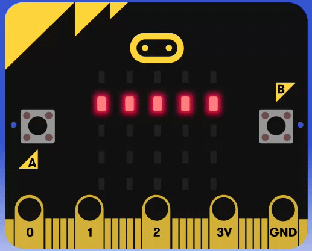
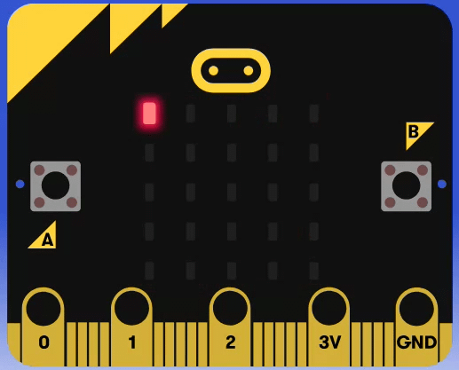
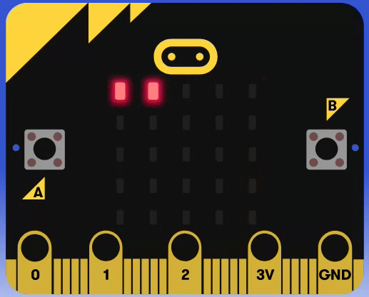
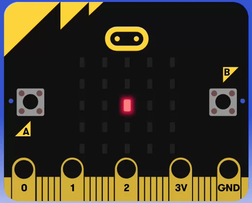
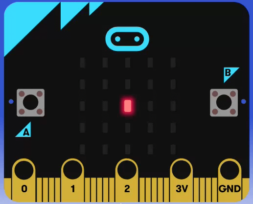

# TP - carte microbit

Dans ce TP, nous allons programmer un objet connecté : __une carte microbit__  

> [!TIP] 
> __Généralités__
> 1. Une carte microbit est un objet programmable. Nous n'avons pas de vraie carte donc nous nous contenterons d'en simuler une en allant sur le site [Makecode](https://makecode.microbit.org/)  
> 2. Pour __chaque__ Question du TP nous allons créer un noueau projet.(aucune autre possibilité pour sauvegarder son programme)      
> Cliquez sur __"Nouveau projet"__ puis nommez celui-ci __Q1__.(Par la suite il faudra créer un projet nommé __Q2__ etc...)  
> 3. Vérifiez bien en haut du site que la section __"Blocs"__ est selectionnée.     
> 4. 2 blocs sont déjà déposés au centre :
>   - `"au démarrage"`  
>   - `"toujours"` : l'endroit où nous poserons chaque bloc

> [!TIP] 
> __Q1__
> Dans la section __"LED"__ prenez le bloc `allumer x 0 y 0` puis placez le dans le bloc central `toujours`. 
> Observez sur la carte que la LED en haut à gauche est allumé.  
> Allez maintenant dans la section __"Base"__ prenez un bloc `pause (ms) 100` que vous mettrez en dessous du premier bloc.  
> Allez dans la section __"LED"__ prenez le bloc `eteindre x 0 y 0`  
> Puis reprenez un bloc `pause (ms) 100`.
> __Astuce : il est possible de faire un clique droit sur un bloc pour le copier-coller__  
> La led en haut à gauche de la carte microbit devrait clignoter frénétiquement !

> [!TIP] 
> __Q2__  
> Retournez sur la page initial en cliquant sur "micro:bit" en haut à gauche de votre page
> Cliquez sur "Nouveau Projet" nommé le __Q2__  
> Créer un programme par bloc qui allume les LED de la deuxième ligne une à une.
> Une nouvelle LED doit s'allumer toutes les 200 ms.   
> On doit donc,
> - Avoir la 1re LED(situé en x=0 et y=1) qui s'allume
> - attendre 200ms
> - La 2ème LED(situé en x=1 et y=1) qui s'allume
> - attendre 200ms
> - etc...
> Vous devriez obtenir ce résultat :  
>   

 

> [!TIP]   
> __Q3__   
> Retournez sur la page initial en cliquant sur "micro:bit" en haut à gauche de votre page  
> Cliquez sur "Nouveau Projet" nommé le __Q3__.  
> Nous allons réeffectuer __exactement le même programme__ qu'à la __Q2__ mais cette fois-ci avec moins de blocs. 
> Pour cela, nous allons utiliser une __Boucle__.    
> Allez dans la sections __Boucles__ et prenez le bloc `"pour index variant de 0 à 4"` puis glissez le dans le bloc `toujours`.   
> Prenez maintenant un bloc `allumer x0 y0` et un bloc `pause (ms) 100` et mettez ces 2 blocs dans celui de la boucle(le vert).  
> Allez, maintenant dans la section `Variables` et prenez la variable nommée `index`. Puis déposer la à la place du `x0` dans le bloc `allumer x0 y0`.  
> Enfin, prenez un nouveau bloc de boucle `"pour index variant de 0 à 4"` glissez cette boucle en dessous de la première boucle.  
> Prenez le bloc `"éteindre x0 y0"` et glissez le dans cette 2ème boucle.  
> Prenez la variable nommée `index`. Puis déposer la à la place du `x0` dans le bloc `éteindre x0 y0`.  


> [!WARNING] 
> __Vérification__  
> - Lever la main pour que le professeur viennent vérifier votre travail.  
> - En attendant vous pouvez passer à la question suivante.

> [!TIP] 
> __Q4__  
> Retournez sur la page initial en cliquant sur "micro:bit" en haut à gauche de votre page  
> Cliquez sur "Nouveau Projet" nommé le __Q4__.  
> Réalisez le même programme qu'à la question 3 mais cette fois-ci en allumant l'avant dernière colonne(de haut en bas).
> Vous devriez obtenir ce résultat :  
>    

> [!TIP] 
> __Q5__  
> Retournez sur la page initial en cliquant sur "micro:bit" en haut à gauche de votre page  
> Cliquez sur "Nouveau Projet" nommé le __Q5__.  
> Créer un programme qui affiche les LED de chaque ligne une à une.    
> Vous devriez obtenir ce résultat :  
>   

> [!NOTE]
> __Astuces pour la Q5__ : pour réaliser cet exercice facilement il va falloir mettre une boucle dans une boucle.   
> Attention chaque boucle doit avoir __sa propre variable__(en rouge) ces 2 variables ne doivent donc pas avoir le même nom. Pour cela cliquer dessus puis sur "Renommer la variable..." en donnant le nom que vous souhaitez.   

> [!WARNING] 
> __Vérification__  
> - Lever la main pour que le professeur viennent vérifier votre travail.  
> - En attendant vous pouvez passer à la question suivante.

> [!TIP] 
> __Q6__  
> Retournez sur la page initial en cliquant sur "micro:bit" en haut à gauche de votre page  
> Cliquez sur "Nouveau Projet" nommé le __Q6__.  
> Créer un programme identique à la __Q5__ mais de telle sorte à ce que les LED s'allume en serpentin.  
> Vous devriez obtenir ce résultat :  
>    

> [!NOTE]
> __Astuces pour la Q6__ :   
> Pour réaliser ce programme vous aurez besoin :  
> - de 2 blocs `pour index variant de 0 à 4`   
> - d'un bloc `si sinon` qui se trouve dans la section __Logique__       
> - de 2 blocs `allumer x0 y0`   
> - d'un bloc `pause (ms) 100`  
> - de 2 blocs de comparaison situé dans la section __Logique__  
> - d'un bloc `<> ou <>` situé dans la section __Logique__  
> Pour effectuer des calculs(notamment une soustraction) il faut aller dans la section Maths.  
> Voici le programme à réaliser à la question 6 écrit en français.    
> ```
> Pour numéro_de_ligne allant de 0 à 4 
>       Pour numéro_de_colonne allant de 0 à 4 
>               si numéro_de_ligne est égal à 1 OU numéro_de_ligne est égal à 3 
>                   allumer la led situé en x=4-numéro_de_colonne y=numéro_de_ligne
>               sinon 
>                   allumer la led situé en x=numéro_de_colonne y=numéro_de_ligne
> ```


> [!TIP] 
> __Q7__  
> Retournez sur la page initial en cliquant sur "micro:bit" en haut à gauche de votre page  
> Cliquez sur "Nouveau Projet" nommé le __Q7__.  
> Dans cette question nous allons utiliser un nouveau bloc qui se nomme `Lorsque le bouton A est pressé`. Il est évidemment possible de changer le bouton A en bouton B.  
> Ce bloc permet d'exécuter du code lorsque l'on touche à un des 2 boutons situés autour de la carte microbit.  
> Voici le programme à créer.  
> ```
> Allume la LED du milieu 
> Lorsqu'on appuie sur le bouton B, on allume la LED à sa droite tout en éteignant celle précédemment allumé 
> Lorsqu'on appuie sur le bouton A, on allume la LED juste en dessous de celle allumé tout en éteignant celle précédemment allumé.  
> ```
> Vous devriez obtenir ce résultat :  
>    

> [!NOTE]
> __Astuces pour la Q7__ : il faut mémoriser dans 2 variables la coordonée x et y de la led allumé.  
> Ensuite selon la situation on modifie ces valeurs pour allumer la led aux bonnes coordonnées.  


> [!WARNING] 
> __Vérification__  
> - Lever la main pour que le professeur viennent vérifier votre travail.  
> - En attendant vous pouvez passer à la question suivante.

> [!TIP] 
> __Q8__   
> En restant sur le projet de la __Q7__ améliorer votre programme pour que 
> Si on appuie sur le bouton B et que la LED allumée est déjà tout à droite, la LED qui doit s'allumer est sur la même ligne mais tout à gauche.   
>  Si on appuie sur le bouton A et que la LED allumée est déjà tout en bas, la LED qui doit s'allumer est sur la même colonne mais tout en haut.    
> Vous devriez obtenir ce résultat :  
>    

> [!TIP] 
> __Q9 : Bonus__     
> A l'aide de ce que vous avez appris lors de ce TP, créer un programme de votre choix.
> Il est également possible de parcourir toutes les sections afin de se renseigner sur d'autres blocs pour créer ce programme.
